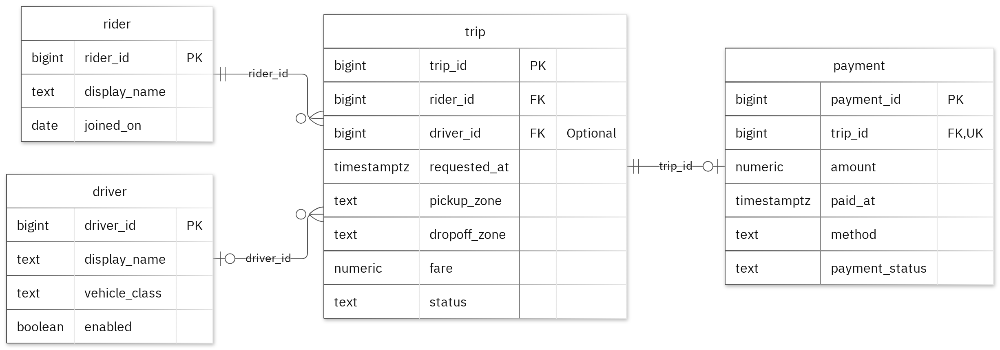
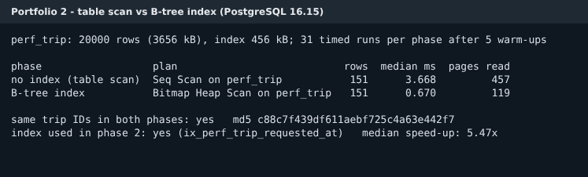

# MIT 8103 Advanced Database Systems

**Ride-Hailing Trip and Payment Records** · Emike Isogie · Student ID 301896878

## Case study

My case study is Ride-Hailing Trip and Payment Records, for a fictional ride-hailing service in Lagos. Riders request trips, drivers are matched to them, and each completed trip is paid for once. The database serves dispatchers creating trips and assigning available drivers, analysts reviewing trip activity, and payment operators recording charges. It stores riders, drivers, trips and payments in four tables named rider, driver, trip and payment, plus a MongoDB collection of trip events. It supports these operations: create trips and assign available drivers; review trips by status, time range and rider; summarise trip counts and fares by pickup zone; and record a payment for a trip. All records are fictional.

## Portfolio 1: Database Design and Modelling

I organised the relational design into four tables. Integer primary keys identify records, foreign keys preserve the links, and real-world identifiers such as phone number, licence and plate are kept unique. Check constraints tie each trip status to the fields it needs. A partial UNIQUE index on driver_id applies only when status is assigned or in_progress, which stops a driver having two active trips without blocking their trip history. A trigger rejects payments for trips that are not completed or that do not match the fare. The normalisation notes take the sample data from an unnormalised spreadsheet through 1NF, 2NF and 3NF. All 30 deliberately invalid inserts were rejected with the expected error, and the valid sample rows were unchanged.

Figure 1. Tables, keys and relationships. PK: primary key; FK: foreign key; UK: unique value.

<!-- PAGE BREAK -->

## Portfolio 2: Query Processing and Optimisation

I ran three SQL queries against the sample records, each with its execution plan. The four-table join returned 1 row, Avery Quinn with Morgan Lee, which is correct because only one trip is both completed and paid. After ANALYZE, the planner chose sequential scans for these one-page tables, which is the cheaper option at that size. For the index comparison, I used 20,000 separate, seeded performance rows and the same two-day time-range predicate in both phases. The median of 31 timed runs fell from 3.668 ms with a table scan to 0.670 ms with a B-tree index on requested_at. Both phases returned the same 151 trips, and the plan confirmed the index was used. The page counts explain the gain: 457 pages read without the index, 119 with it. These timings apply to this query and environment.

Figure 2. Scan versus index: median times, plans and result check.

## Portfolio 3: Transactions and Concurrency

I used a temporary counter on trip to test COMMIT, ROLLBACK and READ COMMITTED isolation with two live sessions. The uncommitted update remained hidden from the other session, and ROLLBACK restored the earlier committed value. Without locking, two increments left the counter at 2, a lost update. With SELECT FOR UPDATE, Session B waited on Session A's row lock, which pg_stat_activity confirmed, and the final value was 3. Under REPEATABLE READ the same race made Session B fail with a serialization error instead of losing data silently. The helper column was dropped afterwards, and a fingerprint check confirmed that the trip's business fields were unchanged.

## Portfolio 4: NoSQL and Advanced Data Models

I used a trip_events collection for the case's event documents. Each event embeds a snapshot of the rider and driver at that moment, and its details field changes shape by event type. Two sample events were inserted and four queries returned the expected results. A unique index rejected a duplicate event ID. The evidence was produced on FerretDB 1.24, a MongoDB-compatible server. It does not support $jsonSchema validators, so the invalid date-type test is defined in the mongosh script but was not verified in this run. PostgreSQL remains the source of truth and continues to enforce its relational rules.

<!-- PAGE BREAK -->

## Portfolio 5: Distributed and Cloud Database Exercise

I proposed three MongoDB replica members across separate failure zones. Three is the smallest number that keeps a voting majority after losing one zone. The discussion covers primary elections, majority write acknowledgement to avoid rolled-back writes after failover, secondary lag and read preference, and sharding trade-offs for trip_events. A hashed trip_id key was chosen over a timestamp key, which would send every insert to one shard. Replication supports availability, while backups address recovery. PostgreSQL needs its own plan: a streaming standby, a failover tool or managed service, and WAL archiving. This is the permitted discussion option; no live replica set or failover test was deployed.

## Repository and evidence

https://github.com/EmikeIs/Isogie_Emike_301896878

Each portfolio folder contains the SQL and JavaScript, a README explaining how it was implemented and tested, saved outputs in results/, and output images in screenshots/. Query plans are in portfolio-2-query-optimisation/plans/. The script scripts/run_all.sh rebuilds the database and regenerates every output. The outputs were produced on PostgreSQL 16.15 and Node.js 22.

## Individual reflection

I kept rider, driver, trip and payment in separate tables so their details could be maintained without repeating them in every related record. The hardest design rule was "one active trip per driver". A plain unique constraint would have blocked a driver's history, so I used a partial unique index instead. I also learnt that rules spanning two tables, such as paying only completed trips, need a trigger. Making that trigger run AFTER the row checks gave clearer error messages. The two-session exercise showed that both sessions can read the same value before either update is committed. Locking the row before reading preserves both increments, while REPEATABLE READ detects the conflict and forces a retry. The index comparison showed why I need to check the execution plan and page counts as well as the final answer: the same result can require very different amounts of database work. The planner's choices also depend on up-to-date statistics.

## AI-use declaration

I used Claude (Anthropic) and GitHub Copilot to help prepare the database model, SQL and JavaScript scripts, and the written explanations. The scripts were run against PostgreSQL and a MongoDB-compatible server to produce the saved outputs and result images. I reviewed the scripts and outputs, re-ran them, and checked the figures in this summary against the results files. I remain responsible for checking and explaining the submitted work.

## References

- [PostgreSQL: constraints](https://www.postgresql.org/docs/16/ddl-constraints.html)
- [PostgreSQL: partial indexes](https://www.postgresql.org/docs/16/indexes-partial.html)
- [PostgreSQL: EXPLAIN](https://www.postgresql.org/docs/16/using-explain.html)
- [PostgreSQL: isolation](https://www.postgresql.org/docs/16/transaction-iso.html)
- [PostgreSQL: row locks](https://www.postgresql.org/docs/16/explicit-locking.html)
- [PostgreSQL: high availability](https://www.postgresql.org/docs/16/high-availability.html)
- [MongoDB: data modelling](https://www.mongodb.com/docs/manual/data-modeling/)
- [MongoDB: schema validation](https://www.mongodb.com/docs/manual/core/schema-validation/)
- [MongoDB: replication](https://www.mongodb.com/docs/manual/replication/)
- [MongoDB: write concern](https://www.mongodb.com/docs/manual/reference/write-concern/)
- [MongoDB: sharding](https://www.mongodb.com/docs/manual/sharding/)
- [FerretDB](https://docs.ferretdb.io/)
- [node-postgres](https://node-postgres.com/) and [MongoDB Node.js driver](https://www.mongodb.com/docs/drivers/node/current/)
- [Graphviz](https://graphviz.org/) and [Mermaid: ER diagrams](https://mermaid.js.org/syntax/entityRelationshipDiagram.html)
