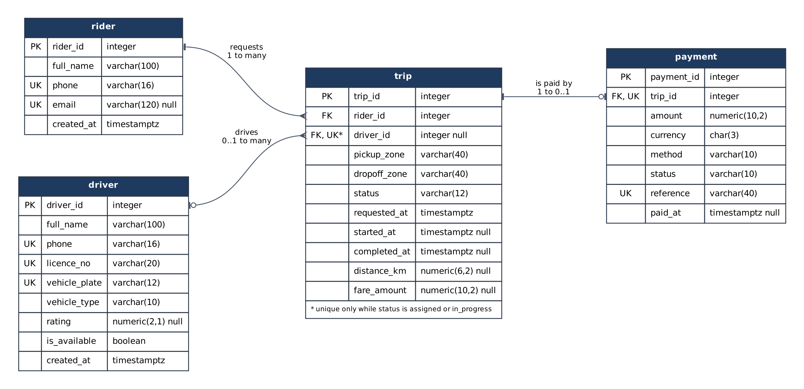
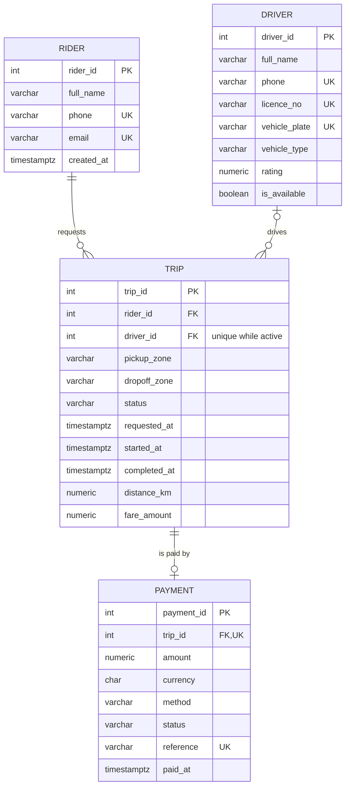

# Portfolio 1: Database Design and Modelling

## The case study

The system records trips and payments for a fictional ride-hailing service operating in Lagos. Riders request trips, drivers are matched to them, and each finished trip is paid for once. Three groups use the database. Dispatchers create trips and assign available drivers. Analysts review trips by status, time range and rider, and summarise trip counts and fares by pickup zone. Payment operators record the charge for each completed trip.

The main data is held in four tables: `rider`, `driver`, `trip` and `payment`. All names, phone numbers, plates and references are made up.

## ER diagram



The diagram source is [`er/er_diagram.dot`](er/er_diagram.dot) and can be re-rendered with Graphviz. A Mermaid version is below so GitHub draws it in the page.



## Relational schema

```
rider   (rider_id PK, full_name, phone UK, email UK, created_at)
driver  (driver_id PK, full_name, phone UK, licence_no UK, vehicle_plate UK,
         vehicle_type, rating, is_available, created_at)
trip    (trip_id PK, rider_id FK -> rider, driver_id FK -> driver,
         pickup_zone, dropoff_zone, status, requested_at, started_at,
         completed_at, distance_km, fare_amount)
payment (payment_id PK, trip_id FK -> trip UK, amount, currency, method,
         status, reference UK, paid_at)
```

A rider can have many trips. A trip has exactly one rider. A trip has no driver while it waits for a match and one driver after that, and a driver builds up many trips over time. A trip has at most one payment, because `payment.trip_id` is unique.

## Keys and constraints

Every table uses an integer identity column as its primary key. The real-world identifiers (phone numbers, driving licence, number plate, payment reference) are kept as `UNIQUE` columns instead. They can change or be entered wrongly, and a short integer is cheaper to carry in every foreign key.

The trip status is the heart of the design. A trip moves from `requested` to `assigned`, then `in_progress`, then `completed`, or it can be `cancelled` before it starts. Each stage needs different fields to be filled, so I wrote one `CHECK` per rule rather than one large condition. That way the error message names the exact rule that was broken. A requested trip must have no driver. An assigned, started or completed trip must have one. A started trip needs `started_at`. A completed trip needs an end time, a distance and a fare. Times must run in order, and distance and fare cannot be negative.

The most important rule is that a driver cannot be on two active trips at once. A plain `UNIQUE (driver_id)` would not work, because it would stop a driver from ever having a second trip in their history. Instead I used a partial unique index:

```sql
CREATE UNIQUE INDEX uq_trip_driver_active
    ON trip (driver_id)
    WHERE status IN ('assigned', 'in_progress');
```

The index only contains rows in the two active statuses, so uniqueness is only enforced among them. Completed and cancelled trips drop out of the index and no longer count.

Two payment rules depend on the `trip` table: a payment can only be recorded for a completed trip, and the amount must match the trip's fare. A `CHECK` constraint cannot read another table, so these rules are enforced by the trigger `trg_payment_trip`. I made it an `AFTER` trigger on purpose. The ordinary column checks run first and report their own errors, and the trigger only judges rows that are otherwise valid.

Foreign keys use `ON DELETE RESTRICT`. Deleting a rider who has trips, or a trip that has been paid for, should be refused rather than silently removing financial history. I also added indexes on `trip.rider_id` and `trip.driver_id`, since PostgreSQL does not index foreign keys on its own.

## Normalisation

The full walk-through is in [normalisation.md](normalisation.md). It starts from a dispatcher's spreadsheet with all of a rider's trips packed into one cell. It then shows the same data at 1NF, 2NF and 3NF, and ends with the schema above. The SQL that builds and prints each stage is [`sql/04_normalisation.sql`](sql/04_normalisation.sql), and its output is in [`results/02_normalisation.txt`](results/02_normalisation.txt).

## How it was tested

I wrote 30 inserts that each break one rule on purpose, covering all four tables. The test script runs each one inside its own sub-transaction. It records whether PostgreSQL rejected it, which error code came back and which constraint caught it. Then it compares row counts from before and after.

All 30 were rejected, all 30 raised the expected type of error, and the four tables kept exactly the rows they started with. The full table is in [`results/01_constraint_tests.txt`](results/01_constraint_tests.txt). A short extract:

```
 #  |  table  |               rule                | outcome  | sqlstate | caught by
 25 | trip    | driver has one active trip only   | rejected | 23505    | uq_trip_driver_active
 27 | payment | one payment per trip              | rejected | 23505    | uq_payment_trip
 30 | payment | only completed trips can be paid  | rejected | 23514    | payment_requires_completed_trip

 rejected | accepted | matched_expected_error | total
       30 |        0 |                     30 |    30
```

I also ran the case-study operations end to end in [`sql/05_operations.sql`](sql/05_operations.sql). A rider requests a trip, the first available driver is assigned, and the trip starts and finishes. A payment for the wrong amount is refused, then the correct payment is recorded. The whole script runs inside one transaction and is rolled back at the end, so the sample data stays as it was for the later portfolios. Its output is in [`results/03_operations.txt`](results/03_operations.txt). The new trip in that output has ID 20 rather than 6. That is expected: PostgreSQL does not hand back identity values used by the failed test inserts.

## Files

| File | Purpose |
|---|---|
| `sql/01_schema.sql` | Tables, keys, checks, partial unique index, payment trigger |
| `sql/02_sample_data.sql` | Four riders, three drivers, five trips (one per status), one payment |
| `sql/03_constraint_tests.sql` | The 30 invalid inserts and the before/after check |
| `sql/04_normalisation.sql` | UNF to 3NF stages on the sample data |
| `sql/05_operations.sql` | Request, assign, start, complete and pay, then roll back |
| `er/er_diagram.dot`, `er/er_diagram.png` | ER diagram source and image |
| `results/` | Saved output from every script |
| `run.sh` | Rebuilds the database and regenerates `results/` |

## Running it

PostgreSQL 14 or later is enough; the outputs here were produced on PostgreSQL 16.15. With the usual `PG*` connection variables set:

```bash
./run.sh
```

This drops and recreates a database called `ridehailing` (or whatever `PGDATABASE` names), so point it at a test server.
