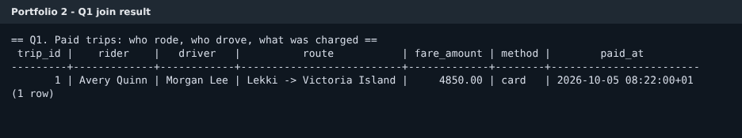
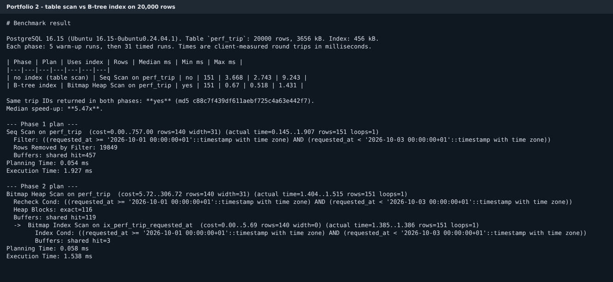

# Portfolio 2: Query Processing and Optimisation

This portfolio has two parts. First, three queries on the sample records from Portfolio 1, each with its execution plan. Second, a benchmark on 20,000 synthetic trips that compares a full table scan with a B-tree index for the same time-range filter.

## Part 1: three queries

All three queries and their plans are in [`sql/01_queries.sql`](sql/01_queries.sql). The full output is in [`results/01_queries_and_plans.txt`](results/01_queries_and_plans.txt). The script refreshes planner statistics with `ANALYZE` before running anything. Without it, the planner had no statistics for the newly loaded tables and guessed 240 trips when there were five.

**Q1, the join.** This joins `trip`, `rider`, `driver` and `payment` to list completed trips with a successful payment. It is the view a payment operator would use to check what was charged. It returned 1 row: trip 1, Avery Quinn with Morgan Lee, Lekki to Victoria Island, ₦4,850 paid by card. That is correct for the sample data, because trip 1 is the only completed trip and the only one with a payment. The inner joins drop the other four trips, either because they have no driver or because they have no payment.



**Q2, the summary by pickup zone.** This counts trips per pickup zone and splits them by status using `count(*) FILTER (WHERE ...)`. That way the table is read once instead of once per status. A `LEFT JOIN` to `payment` keeps unpaid trips in the count. It returned five zones with one trip each, and ₦4,850 collected, all in Lekki.

**Q3, the dispatcher view.** This lists active trips (assigned or in progress) requested between 08:00 and 09:00 on 5 October, with the rider's name. It returned trips 2 and 3.

**What the plans show.** After `ANALYZE`, every table is read with a sequential scan, even though primary-key and foreign-key indexes exist. This is the right decision, not a missed optimisation. Each table fits in a single 8 kB page, so reading that page is cheaper than reading an index page and then the table page.

Before `ANALYZE`, the plan was different. The planner believed `trip` had 240 rows. For Q3 it chose a bitmap scan on the partial index `uq_trip_driver_active`, because that index only holds assigned and in-progress trips, which is exactly what Q3 filters on. This was a useful thing to see. A partial index added for a business rule can also speed up the queries that share its condition. But the main lesson is that the planner is only as good as its statistics.

## Part 2: table scan versus B-tree index

### Set-up

[`sql/02_perf_setup.sql`](sql/02_perf_setup.sql) creates a separate table, `perf_trip`, with 20,000 synthetic trips spread evenly across 1 January to 31 October 2026. Keeping it separate means the benchmark never touches the sample records. The script calls `setseed()` first, so the "random" rows are identical every time it runs and anyone can reproduce the numbers.

The query being measured asks for trips requested in a two-day window:

```sql
SELECT trip_id, rider_id, pickup_zone, status, fare_amount
FROM perf_trip
WHERE requested_at >= '2026-10-01 00:00+01'
  AND requested_at <  '2026-10-03 00:00+01';
```

[`src/benchmark.js`](src/benchmark.js) runs this in two phases with the same predicate each time. Phase 1 has no index on `requested_at`. Phase 2 adds `CREATE INDEX ix_perf_trip_requested_at ON perf_trip (requested_at)` and runs `ANALYZE`. Each phase does 5 warm-up runs and then 31 timed runs, and reports the median. A single timing can be thrown off by anything else happening on the machine, and the median ignores those outliers. The script also sorts the returned trip IDs and hashes them in each phase, to prove both phases returned exactly the same rows.

### Result



| Phase | Plan | Rows | Median | Min | Max |
|---|---|---|---|---|---|
| No index | Seq Scan | 151 | 3.668 ms | 2.743 ms | 9.243 ms |
| B-tree index | Bitmap Index Scan + Bitmap Heap Scan | 151 | 0.670 ms | 0.518 ms | 1.431 ms |

Both phases returned the same 151 trips (identical MD5 of the sorted IDs). The median time fell from 3.668 ms to 0.670 ms, about 5.5 times faster. The plan confirms the new index was used. Raw figures are in [`results/benchmark.json`](results/benchmark.json), and the two plans are in [`plans/`](plans/).

### Why it is faster

The buffer counts in the plans explain the result better than the times do.

Without the index, PostgreSQL read all 457 pages of the table and checked all 20,000 rows. It threw away 19,849 of them to keep 151.

With the index, it read 3 index pages to find the 151 matching row locations, then visited 116 table pages to fetch them. That is 119 pages instead of 457.

The planner chose a bitmap scan rather than a plain index scan for a specific reason. The synthetic trips were inserted in random time order, so the 151 matching rows are scattered across the table. A bitmap scan first collects all the matching locations from the index, sorts them by page, and then visits each page once in order. A plain index scan would jump back and forth between pages. If the table had been loaded in time order, as a real trip log usually is, the matching rows would sit on a handful of neighbouring pages and the gain would be larger.

### Limits of these numbers

The timings come from one laptop-class machine, with the whole table already in memory, and measure the full round trip from Node.js to the server. They show the size of the improvement for this query on this data. They are not a promise of the same ratio elsewhere.

The `EXPLAIN ANALYZE` execution time in each saved plan is a single run. The indexed plan happened to record 1.5 ms on its run, slower than its own median, which shows why I based the comparison on the median of 31 runs and on page counts rather than on one plan's timing.

The index also has costs. It takes 456 kB of disk next to the 3,656 kB table, and every insert into `perf_trip` now has to update it too. On a real trip table that receives constant inserts, I would keep this index because dispatchers and analysts filter on time all day. I would not add one for every column.

## Files

| File | Purpose |
|---|---|
| `sql/01_queries.sql` | Q1 join, Q2 zone summary, Q3 dispatcher view, each with `EXPLAIN ANALYZE` |
| `sql/02_perf_setup.sql` | Builds the 20,000-row `perf_trip` table, seeded so it is repeatable |
| `sql/03_benchmark_query.sql` | The benchmark query in both phases, for running by hand in psql |
| `src/benchmark.js` | Timed benchmark: warm-up, 31 runs per phase, median, result check |
| `results/` | Query output, benchmark summary (`.md` and `.json`) |
| `plans/` | `EXPLAIN (ANALYZE, BUFFERS)` output for each phase |
| `run.sh` | Runs everything above |

## Running it

Run Portfolio 1 first so the database exists, then `npm install` once at the repository root:

```bash
./run.sh
```

Times will differ on another machine; the plan shapes, row counts and page counts should not.
