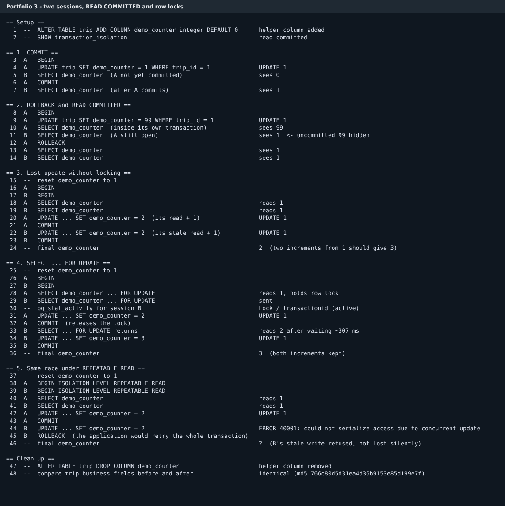

# Portfolio 3: Transactions and Concurrency

## What I tested and how

In a ride-hailing system, many people update the same rows at once. Two dispatchers might touch the same trip, or a driver's app might update a trip while a payment operator is reading it. This portfolio shows what PostgreSQL does in those moments, using two real database sessions rather than a description.

[`src/two_sessions.js`](src/two_sessions.js) opens two separate connections, Session A and Session B, plus a third "observer" connection for setup and checks. It runs each experiment step by step in a fixed order, so the interleaving is the same on every run. Each step is recorded with which session ran it and what came back. [`sql/two_terminal_walkthrough.sql`](sql/two_terminal_walkthrough.sql) has the same steps for typing into two psql windows by hand.

The experiments need a number that both sessions read and increase. I did not want to change real business fields such as the fare, so I added a temporary column, `trip.demo_counter`, at the start and dropped it at the end. Before and after, the script takes an MD5 fingerprint of every real column in every trip. The two fingerprints match, so the business data was not changed.

All results below come from [`results/console.txt`](results/console.txt), with a formatted version in [`results/timeline.md`](results/timeline.md). The database runs at PostgreSQL's default isolation level, `READ COMMITTED`.



## 1. COMMIT

A sets the counter to 1 but has not committed yet. B reads the counter and sees 0. A commits, B reads again and sees 1. A change becomes visible to other sessions at the moment it is committed, not before.

## 2. ROLLBACK and READ COMMITTED

A sets the counter to 99. Inside its own transaction, A sees 99. B reads at the same moment and still sees 1. The uncommitted 99 is hidden from B. This is what `READ COMMITTED` guarantees: no session ever reads another session's unfinished work (no dirty reads). A then rolls back, and both sessions see 1 again. The 99 never existed as far as the rest of the database is concerned.

## 3. The concurrency problem: a lost update

The counter starts at 1, and both sessions want to add one. Each does it the obvious way: read the value, add one in the application, write it back.

| Step | Session A | Session B | Counter |
|---|---|---|---|
| 18–19 | reads 1 | reads 1 | 1 |
| 20–21 | writes 2, commits | | 2 |
| 22–23 | | writes 2 (its stale 1 + 1), commits | 2 |

Two increments were made and the final value is 2, not 3. A's work was silently overwritten. Nothing failed and no error was raised, which is what makes this dangerous. In the real system the same pattern could double-assign a driver, or lose one of two adjustments to a fare.

`READ COMMITTED` does not prevent this. B's read was a correct read of committed data at the time it ran. The problem is that the value changed between B's read and B's write.

## 4. The fix: SELECT ... FOR UPDATE

The counter is reset to 1 and the same race runs again, but each session now reads with `SELECT ... FOR UPDATE`. This locks the row until the transaction ends.

A reads 1 and takes the lock. B issues the same locking read and does not return. While B is stuck, the observer checks `pg_stat_activity` and sees B in a `Lock / transactionid` wait, meaning it is waiting for A's transaction to finish. A writes 2 and commits, which releases the lock. Only then does B's read return. It reads 2, not the stale 1, because PostgreSQL re-reads the row after the lock is released. B writes 3 and commits. B waited about 307 ms, which is how long the script left A holding the lock.

The final value is 3, with both increments kept. The cost is that B had to wait. In a busy system, locks should be held for as short a time as possible.

The simplest safe form in application code is a single statement, `UPDATE trip SET demo_counter = demo_counter + 1 WHERE trip_id = 1`. PostgreSQL locks the row and re-checks it for you. The explicit read-then-write is used here so the race is visible.

## 5. The same race under REPEATABLE READ

As an extra comparison, I ran the unlocked race from experiment 3 again, but with both sessions at `REPEATABLE READ`. Both read 1. A writes 2 and commits. When B tries to write, PostgreSQL refuses with `ERROR 40001: could not serialize access due to concurrent update`. B rolls back and the counter stays at 2.

This is a different way of protecting the data. `FOR UPDATE` prevents the conflict by making B wait. `REPEATABLE READ` lets both sessions run, detects the conflict, and makes B fail. B's stale write is never saved, but the application must catch error 40001 and retry the whole transaction. I would use `FOR UPDATE` for short, predictable updates such as driver assignment. `REPEATABLE READ` or `SERIALIZABLE` with a retry loop suits longer transactions where locking everything up front is impractical.

## Where this appears in the real schema

The driver-assignment step in Portfolio 1 ([`05_operations.sql`](../portfolio-1-database-design/sql/05_operations.sql)) uses `FOR UPDATE SKIP LOCKED` when choosing an available driver. If two dispatchers assign at the same moment, the second skips the driver the first has locked and takes the next one, instead of waiting. The partial unique index `uq_trip_driver_active` is a second safety net. Even if application code got the locking wrong, the database would still refuse to give one driver two active trips.

## Files

| File | Purpose |
|---|---|
| `src/two_sessions.js` | Runs all five experiments with two live sessions and records the timeline |
| `sql/two_terminal_walkthrough.sql` | Same steps for running by hand in two psql windows |
| `results/console.txt` | Raw output of the last run |
| `results/timeline.md` | Same run as tables, step by step |
| `results/summary.json` | Final values the script checks: rollback 1, lost update 2, locked 3, repeatable read 2 |
| `screenshots/two_sessions.png` | Image of the console output |
| `run.sh` | Runs the experiments |

## Running it

Run Portfolio 1 first, then `npm install` once at the repository root:

```bash
./run.sh
```

The script exits with an error if any final value differs from what is expected, or if the trip fingerprint changes.
