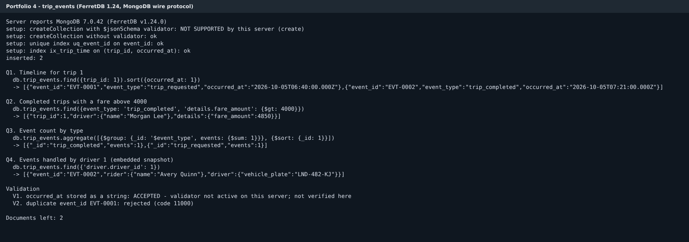

# Portfolio 4: NoSQL and Advanced Data Models

## The model: trip_events as documents

The relational tables in Portfolio 1 hold the current state of each trip: who, where, which status, what fare. They do not hold the trip's history. For that, every request, driver assignment, start, finish or cancellation is recorded as one event document in a MongoDB collection called `trip_events`.

This is a document model, and it suits events for three reasons.

First, events of different types carry different details. A request has a pickup point and an estimated fare. A completion has the distance, duration, final fare and payment reference. In a relational table this means either many columns that are usually empty, or a separate table per event type. In a document, the `details` field simply holds whatever that event needs.

Second, events are written once and never updated. Most of the relational protections I built in Portfolio 1 (status checks, update locking) matter much less for a log that only grows.

Third, events are nearly always read by trip ("what happened on trip 1?") or by time. Both are easy to index, and neither needs a join.

## Embedded snapshots

Each event carries a copy of the rider's and driver's details as they were at the time:

```js
{
  event_id: 'EVT-0002',
  trip_id: 1,                          // links back to trip.trip_id in PostgreSQL
  event_type: 'trip_completed',
  occurred_at: ISODate('2026-10-05T07:21:00Z'),
  rider:  { rider_id: 1, name: 'Avery Quinn' },
  driver: { driver_id: 1, name: 'Morgan Lee', vehicle_plate: 'LND-482-KJ', rating_at_time: 4.8 },
  details: {
    distance_km: 12.4, duration_min: 29, fare_amount: 4850,
    payment: { method: 'card', reference: 'PAY-2026-10-05-0001' }
  }
}
```

This is deliberate duplication, and it is the opposite of what normalisation aimed for in Portfolio 1. It is the right choice here for two reasons. An event should record what was true at that moment. If Morgan Lee changes vehicle next month, the October event should still show the car that did the trip. It also means a single document answers "who drove this trip and in what car" without looking anything up.

The cost is that the snapshot is not updated when the master record changes. That is acceptable for history, but it means `trip_events` must never be used as the place to look up a driver's current details. PostgreSQL stays the source of truth for riders, drivers, trips and payments, and keeps enforcing its constraints. The two stores are linked only by `trip_id`, `rider_id` and `driver_id`.

## Implementation

The collection, indexes, sample data, queries and validation tests are in [`mongodb/trip_events.mongosh.js`](mongodb/trip_events.mongosh.js), which runs in `mongosh` against MongoDB. [`src/run_trip_events.js`](src/run_trip_events.js) does the same work through the Node.js driver and saves the output to [`results/`](results/).

**Validation.** The collection is created with a `$jsonSchema` validator. It requires `event_id`, `trip_id`, `event_type`, `occurred_at` and a rider snapshot. It checks that `occurred_at` is a real date, `trip_id` is an integer and `event_type` is one of five known values. The schema leaves `details` open on purpose, since that is the part that varies.

**Indexes.** A unique index on `event_id` stops the same event being recorded twice, for example when a phone app retries a request after a timeout. A compound index on (`trip_id`, `occurred_at`) serves the most common query: one trip's timeline in time order.

## Results



Two sample events for trip 1 were inserted: the request and the completion. They match the PostgreSQL sample data. Four queries returned the expected results.

| Query | What it shows | Result |
|---|---|---|
| Q1. `find({trip_id: 1}).sort({occurred_at: 1})` | A trip's timeline | EVT-0001 trip_requested 06:40, then EVT-0002 trip_completed 07:21 (UTC) |
| Q2. `find({event_type: 'trip_completed', 'details.fare_amount': {$gt: 4000}})` | Filtering on a field that only some event types have | Trip 1, Morgan Lee, 4850 |
| Q3. `aggregate([{$group: {_id: '$event_type', ...}}])` | Counting by type | trip_completed 1, trip_requested 1 |
| Q4. `find({'driver.driver_id': 1})` | Reading the embedded snapshot | EVT-0002, Avery Quinn, LND-482-KJ |

Q2 is the query that shows why the flexible `details` field is useful. `details.fare_amount` exists on completion events and not on request events, and the query needs no special handling for that. Documents without the field simply do not match.

Two validation tests try to insert bad data.

| Test | Expected on MongoDB | Result in this run |
|---|---|---|
| V2. Duplicate `event_id` EVT-0001 | Rejected, code 11000 | **Rejected, code 11000** |
| V1. `occurred_at` stored as the text "2026-10-05 08:14" | Rejected by the validator, code 121 | **Not verified** (see below) |

## How the evidence was produced, and its limits

MongoDB itself could not be installed in the environment where I generated these outputs. I ran the Node.js script against **FerretDB 1.24**, an open-source server that speaks the MongoDB wire protocol (it reports itself as MongoDB 7.0) and stores the documents in PostgreSQL. The inserts, all four queries, both indexes and the duplicate-key test behaved as they would on MongoDB.

FerretDB 1.24 does not support `$jsonSchema` validators. The script detects this, records it in [`results/run_output.md`](results/run_output.md), carries on without the validator, and marks test V1 as not verified rather than reporting it as a pass. It also removes the bad document V1 let through, so the collection ends with the two sample events.

To capture the date-type rejection, run the mongosh script on MongoDB 6 or 7, for example a free MongoDB Atlas cluster or `docker run -d -p 27017:27017 mongo:7`:

```bash
mongosh "mongodb://localhost:27017/ridehailing" --file mongodb/trip_events.mongosh.js
```

On MongoDB, V1 should print `rejected: code 121 DocumentValidationFailure`. Alternatively, run `MONGODB_URI=mongodb://localhost:27017 ./run.sh` to regenerate `results/` and the screenshot from a real MongoDB server.

## Files

| File | Purpose |
|---|---|
| `mongodb/trip_events.mongosh.js` | Collection, validator, indexes, sample events, four queries, two validation tests (mongosh) |
| `src/run_trip_events.js` | Same steps through the Node.js driver, saving results |
| `results/run_output.md`, `.json` | Output of the last run |
| `screenshots/trip_events_run.png` | Image of that output |
| `run.sh` | Runs the Node.js version |
