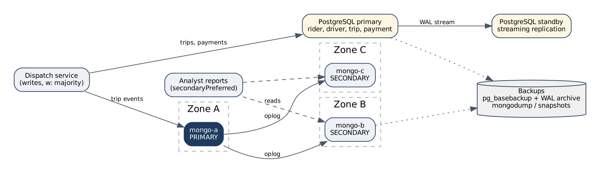

# Portfolio 5: Distributed and Cloud Database Exercise

This portfolio takes the discussion option in the brief. It sets out how the ride-hailing databases would be run across several machines and failure zones, and why. The configuration files are included so the design is concrete. **No live replica set, shard cluster or failover test was deployed.** Every statement about behaviour below comes from the MongoDB and PostgreSQL documentation, not from a test I ran.

## What needs to stay available

The two databases have different jobs. PostgreSQL holds riders, drivers, trips and payments. These are records where a wrong answer costs money, so correctness matters most. MongoDB holds `trip_events` from Portfolio 4: a high-volume history of what happened to each trip. Losing a few seconds of it is annoying but not harmful.

Dispatch is the part that cannot stop. If the database is down, no new trips are matched and drivers sit idle. Analyst reports can wait a few minutes, or read slightly old data, without real harm.

## MongoDB replica set for trip_events

I proposed three replica set members, each in a separate failure zone (for a cloud provider, three availability zones in one region). The setup is in [`config/docker-compose.replica-set.yml`](config/docker-compose.replica-set.yml) and [`config/rs-initiate.js`](config/rs-initiate.js).

**Why three.** A replica set needs a majority of voting members to elect a primary. With three members the majority is two, so the set keeps working if any one zone fails. With two members, losing either one leaves no majority and the set stops accepting writes. That is worse than one server, because there are now two things that can break. Three is the smallest number that actually survives a zone failure.

**Primary elections.** Only the primary accepts writes. Secondaries copy its operation log (the oplog) and apply the same changes. If the secondaries cannot reach the primary for `electionTimeoutMillis` (10 seconds in this design), they hold an election, and the member with the most up-to-date oplog that can win a majority becomes primary. I gave `mongo-a` a higher priority so it is preferred when healthy, which keeps the primary in a predictable place. The drivers handle the switch on their own: with `retryWrites=true`, a write interrupted by the election is retried once against the new primary. Dispatch should expect a pause of roughly ten to twelve seconds during a failover, not an outage.

**Majority acknowledgement.** The design sets the default write concern to `w: "majority"`. A write is only confirmed to the application once two of the three members hold it. This matters at failover. With `w: 1`, the primary confirms a write the moment it has it. If that primary then fails before a secondary copies the write, the new primary never had it. When the old primary rejoins, MongoDB rolls the write back. The application was told "saved" and the event is gone. With `w: "majority"`, an acknowledged write is already on a second member, and whoever wins the next election has it. The cost is latency: every write waits for one cross-zone round trip. For trip events that is a few milliseconds, which is acceptable.

**Secondary lag and where reads go.** Secondaries apply the oplog a little behind the primary. Normally this is milliseconds, but under heavy load or a slow network it can grow to seconds or more. The two kinds of reader are treated differently (see [`config/connection-strings.md`](config/connection-strings.md)).

Dispatch reads from the primary. A dispatcher who has just recorded "driver assigned" must see it on the next screen.

Analyst reports use `secondaryPreferred` with `maxStalenessSeconds=90`. This takes report traffic off the primary. A secondary that has fallen more than 90 seconds behind is skipped, so reports are never badly out of date. Reports also use read concern `majority`, so they only see data that will survive a failover.

This is the consistency trade-off in practice. Dispatch gets strong consistency and pays for it in primary load. Analysts accept slightly stale data in return for spreading the load.

## Sharding trade-offs for trip_events

Replication copies the same data to every member, which helps availability and read capacity but not write capacity or storage. Every member still holds every event. Sharding splits the collection across several replica sets so each holds part of it. I would not shard on day one. A single three-member set handles a large number of events, and sharding adds config servers, `mongos` routers and a lot of operational work. The plan is ready for when growth makes it necessary, and is written out in [`config/shard-trip_events.js`](config/shard-trip_events.js).

The shard key decides almost everything, so I compared three options.

`{ occurred_at: 1 }` looks natural because most queries filter on time, but it is a poor choice. Every new event has the latest timestamp, so every insert goes to whichever shard owns the newest range. One shard takes all the writes while the others sit idle.

`{ pickup_zone: 1, occurred_at: 1 }` suits zone reports. However, there are only ten zones in the data and they are not equally busy. Lekki produces far more trips than Apapa, so the chunks would grow lopsided and could not be split finely enough.

`{ trip_id: "hashed" }` is my choice. Hashing spreads new trips evenly across shards, so writes are balanced. The most common query, "show me every event for this trip", includes `trip_id` and goes to a single shard. The cost is that a time-range report across many trips has to ask every shard and merge the answers. That is acceptable because those reports run on secondaries and are not time-critical.

## Replication is not a backup

A replica set protects against a machine or zone failing. It does not protect against someone running `deleteMany({})` by mistake, or an application bug writing bad data. Those changes are replicated faithfully to every member within milliseconds.

Recovery needs separate backups: daily storage snapshots taken from a secondary (so the primary is not slowed), plus continuous oplog capture for point-in-time recovery. In a managed service such as MongoDB Atlas this is a setting rather than something to build. Restores should be tested on a schedule, because an untested backup is only a hope.

## PostgreSQL needs its own plan

The MongoDB replica set does nothing for the relational data. Trips and payments need their own availability plan.

The proposal is a primary with one hot standby in a different zone, using streaming replication of the write-ahead log (WAL). For payment rows I would use `synchronous_commit = on` with the standby listed in `synchronous_standby_names`. A payment then only counts as committed once the standby has it, the same idea as MongoDB's majority write concern. The cost is that if the standby is unreachable, commits wait, so in practice two standbys with `ANY 1` are needed for this to stay available.

PostgreSQL does not elect a new primary by itself. Failover needs a tool such as Patroni, or a managed service (Amazon RDS Multi-AZ, Azure Database for PostgreSQL with zone-redundant high availability, Google Cloud SQL HA). For a team without dedicated database staff, I would choose the managed option.

Backups use `pg_basebackup` plus continuous WAL archiving, which allows restoring to any point in time. This is the only protection against a bad `UPDATE` on the trip table.

## What happens when things fail

| Failure | MongoDB trip_events | PostgreSQL trips and payments |
|---|---|---|
| One MongoDB member down | Other two keep a majority. If it was the primary, a new one is elected in about 10 s and retryable writes resume | Not affected |
| One zone down | Same as above; at most one member per zone | Standby promoted by the failover tool or managed service |
| Network splits one member away | The isolated member cannot see a majority, steps down and stops taking writes, so there is no split brain | Failover tool must fence the old primary before promoting |
| Accidental delete or bad update | Replicated everywhere; restore from snapshot plus oplog | Replicated to standby; point-in-time restore from WAL archive |
| Whole region lost | Not covered by this design; would need a member or backup copy in a second region | Not covered; needs cross-region backup copies |

## How the design would be tested if deployed

If the compose file were run, the evidence I would collect is: `rs.status()` showing one primary and two secondaries. Then stop `rh-mongo-a` with `docker stop`, time how long `rs.status()` takes to show a new primary, and confirm that a writer looping on inserts with `w: "majority"` and `retryWrites=true` loses no acknowledged events. Finally, restart `rh-mongo-a` and watch it rejoin as a secondary and catch up. I have not done this here, and I have kept the summary wording to match.

## Files

| File | Purpose |
|---|---|
| `config/docker-compose.replica-set.yml` | Three-member replica set, one container per stand-in zone |
| `config/rs-initiate.js` | Replica set configuration, priorities and majority defaults |
| `config/connection-strings.md` | Connection strings for dispatch writes and analyst reads |
| `config/shard-trip_events.js` | Shard key choice and rejected alternatives |
| `diagrams/replica_set.dot`, `.png` | Deployment diagram |
